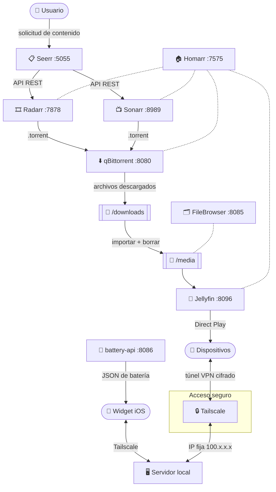

# 🎬 Home Media Server

Servidor multimedia doméstico, autoalojado y **100 % accesible a través de Tailscale**. Ningún puerto está expuesto a internet. Todo el stack levanta con un único comando.

---

## 📑 Tabla de contenidos

- [Servicios](#-servicios)
- [Puertos y acceso](#-puertos-y-acceso)
- [Arquitectura](#-arquitectura)
- [Red: Tailscale](#-red-tailscale)
- [Flujo de descarga y auto-limpieza](#-flujo-de-descarga-y-auto-limpieza)
- [Monitor de batería](#-monitor-de-batería)
- [Instalación](#-instalación)
- [Configuración inicial (una sola vez)](#-configuración-inicial-una-sola-vez)
- [Estructura del proyecto](#-estructura-del-proyecto)
- [Solución de problemas](#-solución-de-problemas)

---

## 🧩 Servicios

| Servicio | Rol | Imagen | Puerto |
|----------|-----|--------|--------|
| **Radarr** | Gestión y descarga automática de películas. | `linuxserver/radarr` | `7878` |
| **Sonarr** | Gestión y descarga automática de series y episodios. | `linuxserver/sonarr` | `8989` |
| **qBittorrent** | Cliente de descargas P2P. Se pausa automáticamente al llegar a ratio 0. | `linuxserver/qbittorrent` | `8080` |
| **Seerr** | Interfaz de peticiones de contenido, integrada con Radarr y Sonarr. | `seerr-team/seerr` | `5055` |
| **Jellyfin** | Servidor de streaming open source con metadata y pósters. | `linuxserver/jellyfin` | `8096` |
| **Homarr** | Dashboard central con accesos rápidos a todos los servicios. | `ajnart/homarr` | `7575` |
| **FileBrowser** | Explorador de archivos web para gestionar y limpiar el almacenamiento. Corre bajo UID 1000. | `filebrowser/filebrowser` | `8085` |
| **battery-api** | Expone el estado de batería de la laptop como JSON. Monta `/sys/class/power_supply/BAT1` en solo lectura. | `python:3.9-alpine` | `8086` |
| **Tailscale** | VPN mesh. Corre con `network_mode: host` y persistencia del estado en disco. | `tailscale/tailscale` | — |

---

## 🔌 Puertos y acceso

Todos los servicios son accesibles **únicamente desde la IP de Tailscale del servidor** (`100.x.x.x`). Ningún puerto está expuesto a internet.

| Servicio | URL |
|----------|-----|
| 🏠 **Homarr** | `http://100.x.x.x:7575` |
| 🎥 **Jellyfin** | `http://100.x.x.x:8096` |
| 📋 **Seerr** | `http://100.x.x.x:5055` |
| 🎞️ **Radarr** | `http://100.x.x.x:7878` |
| 📺 **Sonarr** | `http://100.x.x.x:8989` |
| ⬇️ **qBittorrent** | `http://100.x.x.x:8080` |
| 🗂️ **FileBrowser** | `http://100.x.x.x:8085` |
| 🔋 **Battery API** | `http://100.x.x.x:8086` |

---

## 🏗️ Arquitectura



---

## 🔒 Red: Tailscale

El servidor opera **sin puertos expuestos a internet**. Todo el acceso remoto pasa por el túnel cifrado de Tailscale.

- El contenedor corre con `network_mode: host` y privilegios de red elevados.
- El estado se persiste en `./tailscale-config` → `/var/lib/tailscale`, por lo que el servidor se reconecta automáticamente sin re-autenticarse tras un reinicio.
- El servidor recibe una **IP fija** en la red Tailscale (`100.x.x.x`) que no cambia.
- Los clientes (celular, laptop) solo necesitan tener Tailscale instalado y conectado a la misma cuenta.

**Primera autenticación:**
```bash
docker exec tailscale tailscale up
# Abrí el link que aparece para vincular el servidor a tu cuenta
```

---

## 🧹 Flujo de descarga y auto-limpieza

```
Petición en Seerr
      │
      ▼
Radarr / Sonarr busca el torrent
      │
      ▼
qBittorrent descarga a /downloads
      │  ratio 0 alcanzado → pausa automática del seedeo
      ▼
Radarr / Sonarr importa y mueve a /media
      │  opción "Remove" activa → borra el archivo de /downloads
      ▼
/media/movies  o  /media/tv
(disponible en Jellyfin)
```

**Dónde configurar cada cosa:**

- **qBittorrent** → `Settings → BitTorrent → Seeding Limits`: ratio máximo `0`, acción `Pause`.
- **Radarr / Sonarr** → `Settings → Download Clients`: activar **"Remove Completed Downloads"**.

---

## 🔋 Monitor de batería

El servicio `battery-api` forma parte del stack y **se levanta automáticamente** con el resto al hacer `docker compose up -d`.

Lee el estado de la batería directamente del sistema operativo montando `/sys/class/power_supply/BAT1` en modo solo lectura, sin privilegios adicionales.

**Respuesta del endpoint** (`GET http://100.x.x.x:8086`):
```json
{
  "percent": 74,
  "plugged": true,
  "status": "Charging"
}
```

Usado por un widget de iOS (ej.: Scriptable) vía Tailscale para mostrar el nivel de batería del servidor.

> Si tu laptop expone la batería como `BAT0` en lugar de `BAT1`, ajustá el volumen en el `docker-compose.yml` antes de levantar el stack.

---

## 🚀 Instalación

**1. Clonar el repositorio:**
```bash
git clone <url-del-repo>
cd bot
```

**2. Levantar el stack:**
```bash
docker compose up -d
```

**3. Autenticar Tailscale (primera vez):**
```bash
docker exec tailscale tailscale up
```

---

## ⚙️ Configuración inicial (una sola vez)

Accedé a cada servicio por su URL de Tailscale y completá la configuración base:

1. **Radarr** (`:7878`) → `Settings → Media Management`: definir carpeta raíz `/movies`. `Settings → Download Clients`: agregar qBittorrent.
2. **Sonarr** (`:8989`) → misma configuración que Radarr, carpeta raíz `/tv`.
3. **qBittorrent** (`:8080`) → `Settings → BitTorrent`: ratio máximo `0`, acción `Pause`.
4. **Seerr** (`:5055`) → conectar con Jellyfin, Radarr y Sonarr desde el asistente de configuración inicial.
5. **Homarr** (`:7575`) → agregar los servicios del stack para tener el dashboard completo.

---

## 📁 Estructura del proyecto

```
.
├── docker-compose.yml          # Definición del stack completo
├── battery_server.py           # Script leído por el servicio battery-api
├── config/
│   ├── qbittorrent/            # Configuración persistente de qBittorrent
│   ├── radarr/                 # Configuración persistente de Radarr
│   ├── sonarr/                 # Configuración persistente de Sonarr
│   └── plex/
├── media/
│   ├── movies/                 # Biblioteca de películas
│   └── tv/                     # Biblioteca de series
├── downloads/                  # Descargas activas (se vacía automáticamente)
├── tailscale-config/           # Estado de Tailscale (/var/lib/tailscale)
├── homarr/
│   ├── configs/
│   ├── icons/
│   └── data/
├── filebrowser-db/             # Base de datos de FileBrowser
├── jellyfin-config/            # Configuración persistente de Jellyfin
└── overseerr_config/           # Configuración persistente de Seerr
```

---

## 🛠️ Solución de problemas

**No puedo acceder a ningún servicio desde mi dispositivo:**
Verificá que Tailscale esté activo en el servidor (`docker compose ps tailscale`) y en tu dispositivo. Usá la IP `100.x.x.x` asignada por Tailscale, no la IP local del router.

**Radarr / Sonarr dicen que no hay carpeta raíz:**
Entrá a `Settings → Media Management` en cada app y definí la carpeta raíz antes de agregar contenido.

**qBittorrent no para de seedear:**
Confirmá que en `Settings → BitTorrent → Seeding Limits` el ratio máximo sea `0` y la acción sea `Pause`.

**El disco se llena pese a la auto-limpieza:**
Verificá que "Remove Completed Downloads" esté activo en Radarr/Sonarr (`Settings → Download Clients`). Podés limpiar `/downloads` manualmente desde **FileBrowser** (`:8085`).

**battery-api no responde:**
```bash
docker compose logs battery-api
```
Verificá que el path `/sys/class/power_supply/BAT1` exista en el servidor. Si usás `BAT0`, actualizá el volumen en el compose.

**Tailscale se desconecta tras reinicio:**
El volumen `./tailscale-config` debe existir y tener los permisos correctos. Si el contenedor pide re-autenticación, corré `docker exec tailscale tailscale up` de nuevo.
