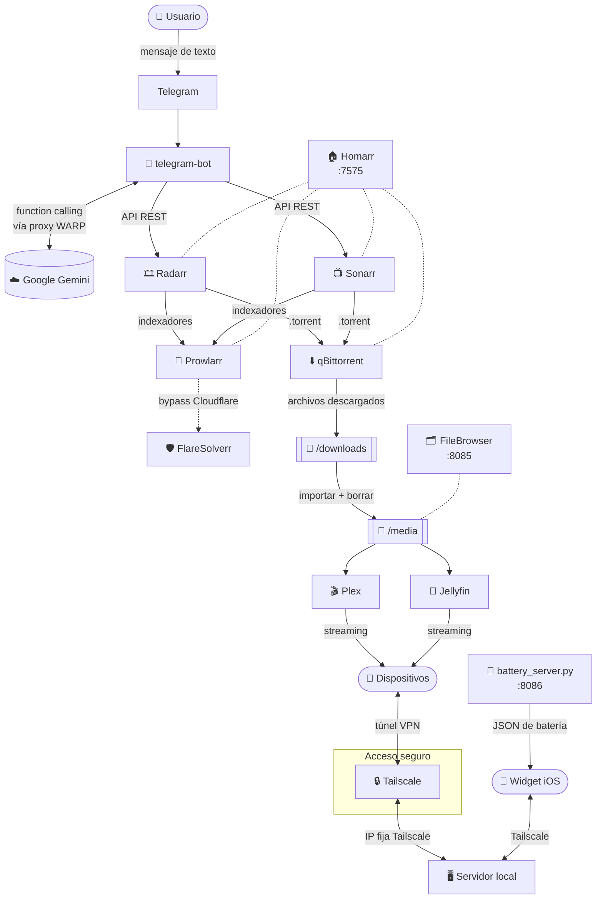

# 🎬 Home Media Server — Bot con IA + Tailscale

Servidor multimedia doméstico, autoalojado y operado por un **bot de Telegram con inteligencia artificial**. Escribís una película o serie en lenguaje natural y el sistema la busca, descarga, organiza y deja disponible para streaming — sin tocar nada más.

La infraestructura corre en una **laptop Lenovo** como servidor local y es accesible de forma **exclusiva y segura a través de Tailscale**. No hay puertos expuestos al internet público.

> Ejemplo: escribís *"quiero ver Oppenheimer"* en Telegram y, minutos después, la película aparece en tu Plex.

---

## 📑 Tabla de contenidos

- [Características](#-características)
- [Arquitectura](#-arquitectura)
- [Servicios del stack](#-servicios-del-stack)
- [Puertos y acceso](#-puertos-y-acceso)
- [Red segura: Tailscale](#-red-segura-tailscale)
- [Flujo de descarga y auto-limpieza](#-flujo-de-descarga-y-auto-limpieza)
- [Monitor de batería (battery_server.py)](#-monitor-de-batería-battery_serverpy)
- [Requisitos](#-requisitos)
- [Instalación](#-instalación)
- [Configuración (.env)](#-configuración-env)
- [Uso del bot](#-uso-del-bot)
- [Cómo funciona por dentro](#-cómo-funciona-por-dentro)
- [Estructura del proyecto](#-estructura-del-proyecto)
- [Solución de problemas](#-solución-de-problemas)
- [Notas de privacidad y responsabilidad](#-notas-de-privacidad-y-responsabilidad)

---

## ✨ Características

- 🤖 **Control por lenguaje natural** — pedís contenido por chat sin comandos ni interfaces web.
- 🧠 **IA con function calling** — Gemini interpreta el pedido, elige qué acción ejecutar y con qué argumentos; el bot controla la ejecución.
- 🎞️ **Películas, series completas y episodios sueltos** — los tres casos cubiertos.
- 📥 **Descarga y organización automática** — Radarr/Sonarr filtran calidad, descargan y renombran/mueven los archivos.
- 🧹 **Auto-limpieza del almacenamiento** — qBittorrent para el seedeo al llegar a ratio 0 y Radarr/Sonarr borran el archivo de `downloads` al importarlo a `media`.
- 📺 **Streaming en red local** — Plex y Jellyfin sirven el contenido a cualquier dispositivo de la red.
- 🗂️ **Gestión de archivos** — FileBrowser provee un explorador web para administrar el servidor directamente desde el navegador.
- 🔒 **Acceso exclusivo por Tailscale** — ningún puerto está expuesto a internet; todo el acceso pasa por el túnel VPN cifrado.
- 🔐 **Tráfico del bot cifrado** — las llamadas a Gemini salen por el proxy SOCKS5 de Cloudflare WARP.
- 🐳 **100 % Dockerizado** — todo el stack levanta con un solo `docker compose up -d`.

---

## 🏗️ Arquitectura



---

## 🧩 Servicios del stack

| Servicio | Rol | Imagen | Puerto |
|----------|-----|--------|--------|
| **telegram-bot** | Interfaz conversacional con IA (Gemini). Orquesta todo el sistema. | build local | — |
| **Radarr** | Gestor automatizado de películas: búsqueda, calidad, descarga y organización. | `linuxserver/radarr` | `7878` |
| **Sonarr** | Gestor automatizado de series y episodios. Misma lógica que Radarr. | `linuxserver/sonarr` | `8989` |
| **Prowlarr** | Gestor centralizado de indexadores para Radarr y Sonarr. | `linuxserver/prowlarr` | `9696` |
| **qBittorrent** | Cliente de descargas P2P. Auto-pausa al llegar a ratio 0. | `linuxserver/qbittorrent` | `8080` |
| **Plex** | Servidor de streaming con metadata y pósters. Usa `network_mode: host`. | `linuxserver/plex` | `32400` |
| **Jellyfin** | Servidor de streaming alternativo, 100 % open source. | `linuxserver/jellyfin` | `8096` |
| **Homarr** | Dashboard central con accesos rápidos a todos los servicios. | `ajnart/homarr` | `7575` |
| **FileBrowser** | Explorador de archivos web para gestionar y limpiar el almacenamiento. | `filebrowser/filebrowser` | `8085` |
| **Seerr** | Interfaz de peticiones de contenido (Jellyseerr compatible con Radarr/Sonarr). | `seerr-team/seerr` | `5055` |
| **FlareSolverr** | Resuelve desafíos anti-bot de Cloudflare para los indexadores. | `flaresolverr/flaresolverr` | `8191` |
| **WARP** | Proxy SOCKS5 (Cloudflare WARP) para cifrar el tráfico del bot hacia Gemini. | `caomingjun/warp` | `1080` |
| **Tailscale** | VPN mesh para acceso remoto seguro. Corre con `network_mode: host`. | `tailscale/tailscale` | — |
| **battery_server.py** | Script Python externo (no en compose). Expone el estado de batería como JSON. | script local | `8086` |

---

## 🔌 Puertos y acceso

Todos los servicios son accesibles **únicamente desde la IP de Tailscale del servidor** (ej.: `100.x.x.x`). Ningún puerto está expuesto a internet.

| Servicio | URL local (reemplazar con IP de Tailscale) |
|----------|-------------------------------------------|
| 🏠 **Homarr** (dashboard) | `http://100.x.x.x:7575` |
| 🎬 **Plex** | `http://100.x.x.x:32400/web` |
| 🎥 **Jellyfin** | `http://100.x.x.x:8096` |
| 🔎 **Prowlarr** | `http://100.x.x.x:9696` |
| 🎞️ **Radarr** | `http://100.x.x.x:7878` |
| 📺 **Sonarr** | `http://100.x.x.x:8989` |
| ⬇️ **qBittorrent** | `http://100.x.x.x:8080` |
| 🗂️ **FileBrowser** | `http://100.x.x.x:8085` |
| 📋 **Seerr** | `http://100.x.x.x:5055` |
| 🛡️ **FlareSolverr** | `http://100.x.x.x:8191` |
| 🔐 **WARP** (SOCKS5) | `socks5://warp:1080` (solo red interna de Docker) |
| 🔋 **Battery Server** | `http://100.x.x.x:8086` |

---

## 🔒 Red segura: Tailscale

El servidor **no expone ningún puerto a internet**. El acceso desde celulares, notebooks y cualquier otro dispositivo se hace a través del **túnel VPN cifrado de Tailscale**.

**Cómo funciona:**
- `tailscale` corre en el compose con `network_mode: host` y privilegios elevados para gestionar la interfaz de red del sistema.
- El estado de la conexión se persiste en `./tailscale-config` (mapeado a `/var/lib/tailscale`), así el contenedor se reconecta automáticamente al reiniciar sin necesidad de re-autenticar.
- El servidor obtiene una **IP fija dentro de la red Tailscale** (ej.: `100.x.x.x`) que no cambia nunca.
- Los clientes (celular, laptop) instalan la app de Tailscale y se conectan a la misma cuenta o tailnet para acceder a todos los servicios.

> 💡 Esta arquitectura reemplaza a `nginx-proxy-manager` y elimina la necesidad de abrir puertos en el router, configurar DDNS o gestionar certificados SSL manualmente.

**Activar Tailscale (primera vez):**
```bash
# Verificar que el contenedor esté corriendo
docker compose logs tailscale

# Obtener el link de autenticación
docker exec tailscale tailscale up
```

---

## 🧹 Flujo de descarga y auto-limpieza

El sistema gestiona el almacenamiento de forma automática para no saturar el disco:

```
Pedido por Telegram
       │
       ▼
Radarr / Sonarr busca en Prowlarr
       │
       ▼
qBittorrent descarga a /downloads
       │  (al llegar a ratio 0 → pausa automática del seedeo)
       ▼
Radarr / Sonarr importa y mueve a /media
       │  (opción "Remove" activa → borra el archivo de /downloads)
       ▼
/media/movies o /media/tv
(disponible en Plex y Jellyfin)
```

**Configuración clave en qBittorrent:**
- `Settings → BitTorrent → Seeding Limits`: ratio máximo = `0` → acción = `Pause`.

**Configuración clave en Radarr y Sonarr:**
- `Settings → Download Clients`: opción **"Remove Completed Downloads"** activada para borrar de `/downloads` tras la importación.

---

## 🔋 Monitor de batería (battery_server.py)

Script Python independiente (no forma parte del compose) que corre directamente en el sistema operativo del servidor. Expone el estado de la batería de la laptop en el puerto `8086` como JSON simple.

**Uso típico:**
```bash
python battery_server.py
```

**Respuesta de ejemplo** (`http://100.x.x.x:8086`):
```json
{
  "percent": 74,
  "plugged": true,
  "status": "Charging"
}
```

Este endpoint es consumido por un **widget de iOS** (ej.: Scriptable) que consulta la URL a través de Tailscale para mostrar el estado de la batería del servidor en pantalla.

> ⚠️ Para que el script corra al arrancar el sistema, podés registrarlo como un servicio con `systemd` o en el Planificador de tareas (Windows).

---

## 📋 Requisitos

- **Docker** y **Docker Compose** instalados en el servidor.
- Cuenta de **Tailscale** ([tailscale.com](https://tailscale.com)) con la app instalada en los dispositivos cliente.
- **Token de bot de Telegram** (obtenido con [@BotFather](https://t.me/BotFather)).
- **API key de Google Gemini** ([Google AI Studio](https://aistudio.google.com/)).
- **API keys de Radarr y Sonarr** (generadas dentro de cada app en `Settings → General`).

---

## 🚀 Instalación

### 1. Clonar el repositorio

```bash
git clone <url-del-repo>
cd bot
```

### 2. Crear el archivo de entorno

```bash
cp .env.example .env
```

Editá `.env` con tus tokens y API keys reales (ver [Configuración](#-configuración-env)).

### 3. Levantar el stack

```bash
docker compose up -d
```

### 4. Autenticar Tailscale (primera vez)

```bash
docker exec tailscale tailscale up
# Abrí el link que aparece en consola para autenticar el servidor en tu cuenta
```

### 5. Configuración inicial de las apps (una sola vez)

Accedé a cada servicio usando la **IP de Tailscale** del servidor:

1. **Prowlarr** (`:9696`) → agregá tus indexadores y sincronizalos con Radarr y Sonarr en `Settings → Apps`.
2. **Radarr** (`:7878`) → configurá la carpeta raíz (`/movies`) y el perfil de calidad en `Settings → Media Management`. Copiá la API Key desde `Settings → General` y pegala en `.env`.
3. **Sonarr** (`:8989`) → misma configuración que Radarr, con carpeta raíz `/tv`. Copiá la API Key.
4. **qBittorrent** (`:8080`) → activá el límite de ratio en `Settings → BitTorrent` (ratio = `0`, acción = `Pause`).
5. En **Radarr y Sonarr** → `Settings → Download Clients` → configurá qBittorrent como cliente y activá **"Remove Completed Downloads"**.

### 6. Reiniciar el bot con las API keys nuevas

```bash
docker compose restart telegram-bot
```

---

## ⚙️ Configuración (.env)

| Variable | Descripción | Valor por defecto |
|----------|-------------|-------------------|
| `TELEGRAM_BOT_TOKEN` | Token del bot (BotFather). | — obligatorio |
| `GEMINI_API_KEY` | API key de Google AI Studio. | — obligatorio |
| `GEMINI_MODEL` | Modelo de Gemini a usar. | `gemini-2.5-flash` |
| `RADARR_URL` | URL interna de Radarr en la red Docker. | `http://radarr:7878` |
| `RADARR_API_KEY` | API key de Radarr. | — obligatorio |
| `SONARR_URL` | URL interna de Sonarr en la red Docker. | `http://sonarr:8989` |
| `SONARR_API_KEY` | API key de Sonarr. | — obligatorio |
| `WARP_PROXY` | Proxy SOCKS5 de WARP (solo para el tráfico a Gemini). | `socks5://warp:1080` |
| `HTTP_TIMEOUT` | Timeout en segundos para todas las llamadas HTTP. | `30` |

> ⚠️ **Nota**: `WARP_PROXY` y `HTTP_TIMEOUT` están declarados en el código del bot y leídos desde el entorno, pero en el `docker-compose.yml` actual no están pasados en la sección `environment` del servicio `telegram-bot`. Si los necesitás sobreescribir, agregá esas líneas al compose.

---

## 💬 Uso del bot

Abrí el chat con tu bot en Telegram y escribile en lenguaje natural. No hace falta aprender comandos.

| Comando | Descripción |
|---------|-------------|
| `/start` | Muestra el mensaje de bienvenida con ejemplos. |

**Ejemplos de mensajes:**

| Pedido | Qué hace |
|--------|----------|
| `Quiero ver Oppenheimer` | Busca la película y te muestra opciones para confirmar. |
| `Descargá Breaking Bad` | Busca la serie completa y la manda a Sonarr. |
| `Bajame el S02E05 de Breaking Bad` | Descarga ese episodio puntual. |
| `Buscá la última de Nolan` | Busca películas recientes del director. |

El bot muestra los resultados encontrados, pide confirmación y recién ahí dispara la descarga. Todo se descarga en **1080p** por defecto (según el perfil de calidad configurado en Radarr/Sonarr).

---

## 🔄 Cómo funciona por dentro

1. **Solicitud**: mandás un mensaje al bot de Telegram.
2. **Interpretación (IA)**: el bot envía el mensaje a Gemini (vía el proxy WARP) junto con el catálogo de *tools* disponibles. Gemini decide qué función ejecutar (`search_movie`, `add_series`, `download_episode`, etc.) y con qué argumentos.
3. **Ejecución controlada**: el bot ejecuta la función contra la API de Radarr o Sonarr. Gemini **nunca ejecuta nada por su cuenta**: solo propone la llamada y el bot la valida y corre. El loop se repite hasta que Gemini devuelve texto final (sin más function calls).
4. **Búsqueda y filtro**: Radarr/Sonarr consultan Prowlarr. Si algún indexador está bloqueado por Cloudflare, FlareSolverr resuelve el captcha.
5. **Descarga**: se envía el `.torrent` a qBittorrent. Al llegar al ratio configurado (0), pausa el seedeo automáticamente.
6. **Importación y limpieza**: Radarr/Sonarr detectan la descarga completada, mueven el archivo a `/media` con el nombre correcto y, con la opción "Remove" activa, **borran el archivo original de `/downloads`**.
7. **Consumo**: Plex y Jellyfin detectan el archivo nuevo, bajan la metadata y lo habilitan para streaming en la red Tailscale.

---

## 📁 Estructura del proyecto

```
bot/
├── bot.py                  # Bot de Telegram + integración Gemini + Radarr/Sonarr
├── battery_server.py       # Servidor HTTP de estado de batería (externo al compose)
├── Dockerfile              # Imagen Docker del bot (Python slim)
├── docker-compose.yml      # Definición completa del stack
├── requirements.txt        # Dependencias de Python del bot
├── .env.example            # Plantilla de variables de entorno
├── .env                    # Variables reales (NO versionar)
├── README.md               # Esta documentación
│
├── config/                 # Configuraciones persistentes de cada servicio
│   ├── qbittorrent/
│   ├── prowlarr/
│   ├── radarr/
│   ├── sonarr/
│   ├── plex/
│   └── warp/
│
├── media/                  # Biblioteca de medios (destino final)
│   ├── movies/             # Películas (montada en Radarr, Plex, Jellyfin)
│   └── tv/                 # Series (montada en Sonarr, Plex, Jellyfin)
│
├── downloads/              # Descargas en progreso (se vacía automáticamente)
│
├── tailscale-config/       # Estado persistente de Tailscale (/var/lib/tailscale)
│
├── homarr/                 # Configuración del dashboard
│   ├── configs/
│   ├── icons/
│   └── data/
│
├── filebrowser-db/         # Base de datos de FileBrowser
└── overseerr_config/       # Configuración de Seerr
```

---

## 🛠️ Solución de problemas

**El bot no responde:**
```bash
docker compose logs -f telegram-bot
```
Verificá que `TELEGRAM_BOT_TOKEN` y `GEMINI_API_KEY` sean correctos y que el contenedor `warp` esté arriba.

**"Radarr no tiene ninguna carpeta raíz configurada":**
Entrá a Radarr/Sonarr y definí la carpeta raíz en `Settings → Media Management`.

**No encuentra resultados en los indexadores:**
Confirmá que Prowlarr tenga indexadores activos y sincronizados con Radarr/Sonarr en `Settings → Apps`.

**Indexadores bloqueados por Cloudflare:**
Asegurate de que `flaresolverr` esté corriendo (`docker compose ps`) y configurado como proxy en Prowlarr.

**Errores de conexión a Gemini:**
Verificá que el contenedor `warp` esté activo. Si acabás de levantarlo, esperá los 2 segundos de `WARP_SLEEP` antes de que el proxy esté listo.

**No puedo acceder desde mi celular:**
Verificá que Tailscale esté activo tanto en el servidor (`docker compose ps tailscale`) como en tu dispositivo. Usá la IP `100.x.x.x` que asignó Tailscale al servidor.

**El disco se llena pese a la auto-limpieza:**
Revisá en Radarr/Sonarr `Settings → Download Clients` que la opción "Remove Completed Downloads" esté activa. También podés limpiar `/downloads` manualmente desde **FileBrowser** (`:8085`).

---

## 🔐 Notas de privacidad y responsabilidad

- Este proyecto es para **uso personal y educativo**. Sos responsable de cumplir las leyes de derechos de autor de tu país.
- **Nunca versiones tu `.env`** con tokens y API keys reales. El `.gitignore` debe excluirlo explícitamente.
- El tráfico **P2P de qBittorrent no pasa por Tailscale ni por WARP**. Si la privacidad de las descargas es importante para vos, configurá qBittorrent para enrutar por una VPN usando `network_mode: "service:warp"` u otro contenedor VPN tipo Gluetun.
- **FileBrowser** (`/srv` mapeado al home del usuario) da acceso completo al sistema de archivos del servidor. No lo expongas fuera de Tailscale.
